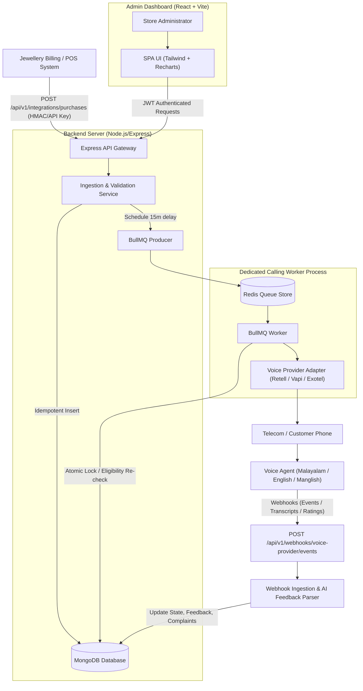
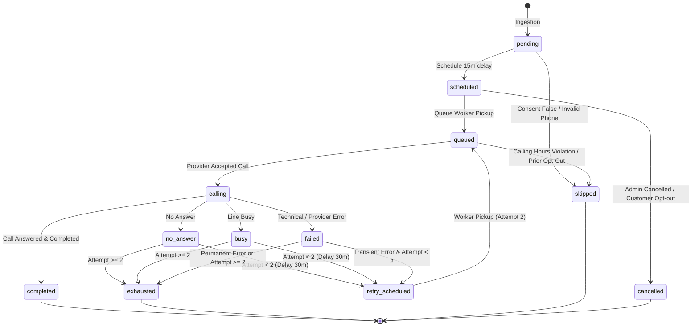
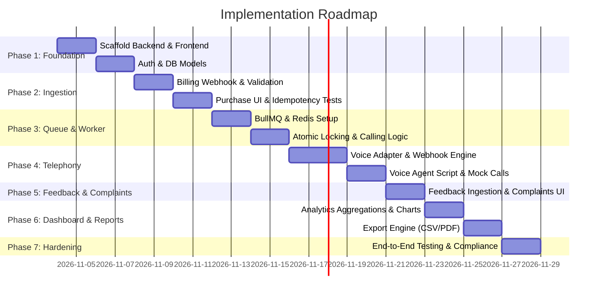

# AI Jewellery Feedback Calling System — Spec-Driven Engineering Plan

> **Document Type:** Spec-Driven Engineering Plan  
> **Source Documents:** [`AI_Jewellery_Feedback_Calling_System_Plan.md`](./AI_Jewellery_Feedback_Calling_System_Plan.md) & [`GEMINI.md`](./GEMINI.md)  
> **Status:** All Phases Implemented & Verified  
> **Backend Tests:** 23 Passing (100%)  
> **Frontend Build:** Passing (Vite + Tailwind + Recharts)  
> **Architecture:** MERN (Node.js, Express, MongoDB, React/Vite) + BullMQ/Redis + Telephony Voice Provider Adapter  

---

## 1. System Architecture & High-Level Topology

The system operates as an asynchronous, event-driven feedback platform. Ingestion is decoupled from calling execution through durable BullMQ queues, backed by MongoDB as the single source of truth for business state.



---

## 2. Specification: Data Models & Schema Contracts

MongoDB schemas must strictly enforce data integrity, tenant/branch isolation, and server-side duplicate prevention.

### 2.1 `Purchases` Collection
```typescript
interface IPurchase {
  _id: ObjectId;
  source: string;                       // e.g. "pos_tally", "manual_entry"
  externalPurchaseId: string;           // Billing system's unique bill/invoice ID
  invoiceNumber: string;                // Printed invoice number
  customerName: string;                 // Customer name
  phoneNumber: string;                  // Original input phone number
  normalizedPhoneNumber: string;        // E.164 format (+919876543210)
  purchaseDate: Date;                   // UTC timestamp from invoice
  totalAmount: number;                  // Bill gross total
  currency: string;                     // "INR" default
  itemsSummary: string;                 // Short summary (e.g. "Gold Necklace 22k 18g")
  branchId?: string;                    // Store location/branch identifier
  feedbackCallConsent: boolean;         // Explicit customer consent
  consentCapturedAt: Date;              // When consent was gathered at billing
  optedOut: boolean;                    // Global opt-out flag for this customer/purchase
  createdAt: Date;
  updatedAt: Date;
}
```
- **Indexes:**
  - `{ source: 1, externalPurchaseId: 1 }` (**Unique Index**)
  - `{ normalizedPhoneNumber: 1 }`
  - `{ invoiceNumber: 1 }`
  - `{ purchaseDate: -1 }`

---

### 2.2 `FeedbackProcesses` Collection
One record per eligible purchase. Orchestrates the calling lifecycle, attempt counter, and feedback progress.
```typescript
interface IFeedbackProcess {
  _id: ObjectId;
  purchaseId: ObjectId;                 // Foreign key to Purchases (Unique)
  callStatus: CallStatusEnum;           // Current call lifecycle status
  feedbackStatus: FeedbackStatusEnum;   // Status of feedback collection
  scheduledAt: Date;                    // Initial scheduled calling time (purchaseDate + 15m)
  nextAttemptAt?: Date;                 // Time of next attempt if retry scheduled
  lastAttemptAt?: Date;                 // Time of most recent attempt
  attemptCount: number;                 // Number of attempts initiated (Max: 2)
  maxAttempts: number;                  // Hard limit: 2
  completedAt?: Date;                   // Timestamp when feedback completed or process ended
  lockLeaseUntil?: Date;                // Distributed concurrency locking timestamp
  lockedBy?: string;                    // Worker ID holding lease
  cancellationReason?: string;          // Reason if cancelled or skipped
  doNotCall: boolean;                   // Opt-out / suppression flag
  requiresFollowUp: boolean;            // Flagged for admin review
  createdAt: Date;
  updatedAt: Date;
}
```
- **Indexes:**
  - `{ purchaseId: 1 }` (**Unique Index**)
  - `{ callStatus: 1, nextAttemptAt: 1 }`
  - `{ scheduledAt: 1 }`
  - `{ doNotCall: 1 }`

---

### 2.3 `CallAttempts` Collection
Historical log of every discrete telephony attempt made.
```typescript
interface ICallAttempt {
  _id: ObjectId;
  feedbackProcessId: ObjectId;         // Ref to FeedbackProcess
  attemptNumber: number;                // 1 or 2
  provider: 'retell' | 'vapi' | 'mock';
  providerCallId?: string;              // Unique call UUID from telephony provider
  status: 'initiated' | 'ringing' | 'in_progress' | 'completed' | 'no_answer' | 'busy' | 'failed' | 'cancelled';
  startedAt: Date;
  answeredAt?: Date;
  endedAt?: Date;
  durationSeconds?: number;
  callCost?: number;
  telephonyError?: {
    code: string;
    message: string;
  };
  createdAt: Date;
  updatedAt: Date;
}
```
- **Indexes:**
  - `{ providerCallId: 1 }` (Sparse, Unique)
  - `{ feedbackProcessId: 1, attemptNumber: 1 }`

---

### 2.4 `Feedbacks` Collection
Captured structured feedback data and AI-extracted sentiment.
```typescript
interface IFeedback {
  _id: ObjectId;
  feedbackProcessId: ObjectId;         // Ref to FeedbackProcess
  callAttemptId: ObjectId;              // Ref to specific CallAttempt
  overallRating: number | null;         // 1 to 5 integer or null
  productSatisfaction: 'positive' | 'neutral' | 'negative' | 'unknown';
  serviceSatisfaction: 'positive' | 'neutral' | 'negative' | 'unknown';
  pricingSatisfaction: 'positive' | 'neutral' | 'negative' | 'unknown';
  feedbackText?: string;                // Raw transcript excerpt of feedback
  summary: string;                      // AI concise conversation summary
  languageUsed: 'malayalam' | 'english' | 'manglish' | 'other';
  sentiment: 'positive' | 'neutral' | 'negative' | 'unknown';
  complaintDetected: boolean;
  complaintSummary?: string;
  suggestion?: string;
  transcriptReference?: string;         // Secured storage pointer (audio/transcript)
  collectedAt: Date;
  reviewedBy?: ObjectId;                // Admin User ID
  reviewedAt?: Date;
  createdAt: Date;
}
```

---

### 2.5 `Complaints` Collection
Tracks customer dissatisfaction and operational resolution.
```typescript
interface IComplaint {
  _id: ObjectId;
  purchaseId: ObjectId;
  feedbackProcessId: ObjectId;
  feedbackId: ObjectId;
  category: 'staff_behavior' | 'quality_craftsmanship' | 'pricing_billing' | 'delay' | 'other';
  priority: 'low' | 'medium' | 'high' | 'urgent';
  description: string;
  status: 'open' | 'in_progress' | 'resolved' | 'closed';
  resolutionNotes?: string;
  resolvedAt?: Date;
  resolvedBy?: ObjectId;
  createdAt: Date;
  updatedAt: Date;
}
```

---

### 2.6 `WebhookEvents` Collection (Idempotency Audit)
```typescript
interface IWebhookEvent {
  _id: ObjectId;
  provider: string;
  externalEventId: string;              // Provider unique webhook event ID
  eventType: string;
  payload: Record<string, any>;
  processedStatus: 'pending' | 'processed' | 'failed' | 'ignored';
  errorMessage?: string;
  receivedAt: Date;
  processedAt?: Date;
}
```
- **Indexes:**
  - `{ provider: 1, externalEventId: 1 }` (**Unique Index**)

---

## 3. Specification: State Machines & Transition Matrix



### Transition Invariants
1. **Completion Lock:** Once `completed`, no further calls can ever be triggered for the purchase.
2. **Attempt Ceiling:** Total attempts $\le 2$. Transition to `retry_scheduled` is forbidden if `attemptCount >= 2`.
3. **Atomic Claiming:** Transitions to `calling` must atomically set `lockLeaseUntil = now + 5 minutes` and increment `attemptCount`.

---

## 4. Specification: Ingestion & Billing Webhook

- **Endpoint:** `POST /api/v1/integrations/purchases`
- **Security:** Header `X-API-Key` or `X-Signature-SHA256` (HMAC verification)
- **Rate Limit:** 60 requests/min per API key

### Request Payload Validation (Zod Schema)
```typescript
const PurchaseIngestSchema = z.object({
  source: z.string().min(1),
  externalPurchaseId: z.string().min(1),
  invoiceNumber: z.string().min(1),
  customerName: z.string().min(1),
  phoneNumber: z.string().min(10),
  purchaseDate: z.string().datetime(),
  totalAmount: z.number().positive(),
  currency: z.string().default("INR"),
  itemsSummary: z.string().min(1),
  branchId: z.string().optional(),
  feedbackCallConsent: z.boolean(),
  consentCapturedAt: z.string().datetime()
});
```

### Ingestion Flow & Idempotency Guarantee
1. **Authenticate request** via `X-API-Key`.
2. **Normalize phone number:** Parse using Google `libphonenumber-js`. If country code missing, default to `+91`. Reject if invalid length/format.
3. **Upsert Purchase:** Perform atomic `findOrCreate` on `{ source, externalPurchaseId }`.
   - If purchase already exists: Return `200 OK` with `{ duplicate: true, purchaseId }`. Do not spawn a new job.
4. **Consent & Suppression Check:**
   - If `feedbackCallConsent === false` or customer phone is in `OptOutRegistry`:
     - Create `FeedbackProcess` in status `skipped`.
     - Return `201 Created` with `{ feedbackProcessCreated: false, reason: "Consent missing or opted out" }`.
5. **Create Feedback Process & Schedule:**
   - Create `FeedbackProcess` with `callStatus: 'scheduled'`, `scheduledAt: purchaseDate + 15 minutes`.
   - Add job to BullMQ queue `calling-queue` with `jobId = feedbackProcess._id.toString()` and delay:
     $$\text{delayMs} = \max(0, \text{scheduledAt.getTime()} - \text{Date.now()})$$
6. Return `201 Created`:
   ```json
   {
     "success": true,
     "message": "Purchase ingested and feedback call scheduled",
     "purchaseId": "65b...",
     "scheduledAt": "2026-11-04T04:45:00.000Z"
   }
   ```

---

## 5. Specification: Queue Worker, Concurrency & Calling Hours

### 5.1 BullMQ Worker Configuration
- **Queue Name:** `feedback-calling-queue`
- **Concurrency:** Configurable (Default: 5 concurrent workers)
- **Job Retention:** Completed: 7 days, Failed: 14 days

### 5.2 Atomic Worker Claim Algorithm
To ensure two parallel workers never dial the same purchase:
```javascript
const leaseDurationMs = 5 * 60 * 1000; // 5 minute lease
const process = await FeedbackProcess.findOneAndUpdate(
  {
    _id: jobId,
    callStatus: { $in: ['scheduled', 'retry_scheduled'] },
    $or: [
      { lockLeaseUntil: { $exists: false } },
      { lockLeaseUntil: { $lt: new Date() } }
    ]
  },
  {
    $set: {
      callStatus: 'queued',
      lockLeaseUntil: new Date(Date.now() + leaseDurationMs),
      lockedBy: workerInstanceId
    }
  },
  { new: true }
);

if (!process) {
  // Job already claimed, completed, or cancelled
  return;
}
```

### 5.3 Calling Hours & Eligibility Pre-Flight Check
Before initiating telephony:
1. **Calling Hours Check:** Indian Telecom (TRAI) permissible commercial call window: **10:00 AM to 08:00 PM IST** (configurable).
   - If current IST time is outside the window:
     - Shift `nextAttemptAt` to 10:15 AM IST next day.
     - Re-enqueue BullMQ job. Set status `scheduled`. Log audit event.
2. **Opt-Out Check:** Check if `process.doNotCall === true` or phone is in `OptOutRegistry`. If true, set status `opted_out`.
3. **Attempt Check:** Verify `process.attemptCount < process.maxAttempts`.
4. **Completion Check:** Ensure `process.feedbackStatus !== 'collected'`.

---

## 6. Specification: Telephony Voice Provider Adapter & Webhook Engine

### 6.1 Provider Adapter Interface (`VoiceProvider.js`)
All voice provider implementations (Retell AI, Vapi, Exotel, Twilio) must adhere to a strict interface:
```typescript
interface IVoiceProvider {
  initiateCall(params: {
    to: string;
    customerName: string;
    invoiceNumber: string;
    itemsSummary: string;
    feedbackProcessId: string;
  }): Promise<{ providerCallId: string; status: string }>;

  verifyWebhookSignature(headers: Record<string, string>, rawBody: Buffer): boolean;

  normalizeWebhookEvent(rawPayload: any): {
    providerCallId: string;
    eventType: 'ringing' | 'in_progress' | 'completed' | 'no_answer' | 'busy' | 'failed';
    durationSeconds?: number;
    rawTranscript?: string;
    extractedFeedback?: {
      rating?: number;
      feedbackText?: string;
      sentiment?: 'positive' | 'neutral' | 'negative';
      complaintCategory?: string;
      suggestion?: string;
    };
    callCost?: number;
    failureReason?: string;
  };
}
```

### 6.2 Webhook Security & Idempotency
- **Endpoint:** `POST /api/v1/webhooks/voice-provider/events`
- **Verification:** Reject any request with HTTP 401 if HMAC signature (`X-Retell-Signature` / `X-Vapi-Signature`) fails.
- **Deduplication:** Check `WebhookEvents` by `{ provider, externalEventId }`. If found, immediately reply `200 OK`.
- **Handling:**
  - Create/Update `CallAttempts` record.
  - Advance `FeedbackProcess` state via State Transition Matrix.
  - If `completed` with feedback: Insert `Feedbacks` record, set `feedbackStatus = 'collected'`.
  - If `rating <= 2` or `complaintCategory` detected: Insert `Complaints` record with status `open`.

---

## 7. Specification: AI Voice Agent Prompt & Behavior

### 7.1 Multi-Language Support
- **Supported Languages:** Malayalam (Kerala dialect), English, Manglish.
- **Dynamic Language Detection:** The agent prompts in bilingual greeting:
  > *"Namaskaram [Customer Name], njan [Store Name] jewellery-il ninnumulla AI assistant aanu. Thangalude recent purchase experience kurichu samsarikkan 2 minute samayam undo?"*  
  > *(If customer responds in English, agent seamlessly transitions to English).*

### 7.2 Core Conversation Script & Turn-Taking
```
1. Intro: State store name + disclose caller is an AI Assistant.
2. Availability: Ask if customer has 2 minutes. If busy, politely ask if we can call back later (triggers retry).
3. Rating: "Ningalude shopping experience engane undayirunnu? 1 muthal 5 vare rating tharamo?" (Scale 1–5).
4. Follow-up: Ask 1 brief optional question regarding staff behavior or jewellery collection.
5. Issues/Complaints: If customer mentions a problem (e.g. billing delay, stone loose), acknowledge politely without arguing:
   "Athu kettu vishamam thonnunnu. Njangal ee vishayam store manager-ude shradhayil pettannu thanne peduthunnathaanu."
6. Polite Wrap-up: Thank customer and end call.
```

### 7.3 Guardrails & Red Lines
- **NO Sensitive Data:** Never ask for OTP, PIN, credit/debit card numbers, or bank details.
- **NO Financial Promises:** Never promise discounts, refunds, repairs, or freebies.
- **NO Rating Pressure:** Never ask or beg for a 5-star rating.
- **Opt-Out Immediate Exit:** If customer says "Don't call me again" / "Enne ini vilikkaruthu", agent responds:
  *"Kshamikkanam, thangalude number list-il ninnu remove cheyyunnathaanu. Nanni."*  
  and immediately signals opt-out to backend.

---

## 8. Specification: REST API Endpoints

| Method | Endpoint | Auth | Purpose |
| :--- | :--- | :--- | :--- |
| `POST` | `/api/v1/auth/login` | Public | Admin login (email + password), returns JWT in httpOnly cookie |
| `POST` | `/api/v1/auth/logout` | JWT | Clears session cookie |
| `GET` | `/api/v1/auth/me` | JWT | Current admin profile and permissions |
| `POST` | `/api/v1/integrations/purchases` | API Key | Ingest purchase from billing system |
| `GET` | `/api/v1/dashboard/overview` | JWT | KPI cards (total purchases, calls scheduled, avg rating, complaints) |
| `GET` | `/api/v1/dashboard/call-statistics`| JWT | Hourly/daily call status distributions |
| `GET` | `/api/v1/purchases` | JWT | Paginated list with search (phone, invoice, name, date) |
| `GET` | `/api/v1/purchases/:id` | JWT | Single purchase details and linked call history |
| `GET` | `/api/v1/feedback-processes` | JWT | All feedback calling processes with status filters |
| `POST` | `/api/v1/feedback-processes/:id/cancel` | JWT | Cancel scheduled call (audit logged) |
| `POST` | `/api/v1/feedback-processes/:id/reschedule`| JWT | Reschedule eligible call (audit logged) |
| `POST` | `/api/v1/feedback-processes/:id/do-not-call` | JWT | Manually add customer to opt-out registry |
| `GET` | `/api/v1/feedback` | JWT | Paginated customer ratings and feedback list |
| `GET` | `/api/v1/feedback/:id` | JWT | Feedback detail with sentiment and transcript |
| `GET` | `/api/v1/complaints` | JWT | Active complaints list |
| `PATCH`| `/api/v1/complaints/:id/resolve` | JWT | Resolve complaint with admin resolution notes |
| `GET` | `/api/v1/reports/summary` | JWT | Aggregated metrics for date range & branch |
| `GET` | `/api/v1/reports/export` | JWT | Export report to CSV or PDF |
| `POST` | `/api/v1/webhooks/voice-provider/events` | HMAC | Ingest provider events (Retell/Vapi) |

---

## 9. Specification: Frontend Admin Dashboard Structure

```
Frontend/
├── src/
│   ├── api/                  # Axios instance with JWT interceptors & error handlers
│   ├── components/
│   │   ├── common/           # Button, Modal, Badge, Pagination, Input, Dropdown
│   │   ├── dashboard/        # KpiCard, RatingBarChart, SentimentPieChart, RecentCallsTable
│   │   ├── feedback/         # StarRatingDisplay, TranscriptViewer, ComplaintBadge
│   │   └── tables/           # Reusable DataGrid with sort, filter, empty & loading states
│   ├── layouts/
│   │   └── DashboardLayout   # Sidebar navigation, header, user profile dropdown
│   ├── pages/
│   │   ├── Login             # Secured admin login screen
│   │   ├── Dashboard         # Overview analytics & live call monitors
│   │   ├── Purchases         # Ingested purchases list with search & inspection modal
│   │   ├── CallingManagement # Scheduled / In-Progress / Failed calls with manual action modals
│   │   ├── Feedback          # Customer ratings, transcripts, sentiment breakdown
│   │   ├── Complaints        # Triage and resolution workflow for customer issues
│   │   ├── Reports           # Date range analytics with CSV/PDF download
│   │   └── Settings          # Calling hours config, delay settings (15m), API credentials
│   └── context/
│       └── AuthContext       # Admin auth state and token lifecycle
```

---

## 10. Phase-by-Phase Implementation Roadmap & Testing Gates



### Phase 1: Project Foundation & Security Architecture
- **Deliverables:**
  - Initialize Node.js backend with Express, Mongoose, Zod, and Vitest.
  - Initialize React + Vite frontend with Tailwind CSS, Lucide icons, and React Router.
  - Setup MongoDB connection with strict schema definitions for `User`, `Purchase`, `FeedbackProcess`.
  - Implement JWT authentication with httpOnly cookie storage, password hashing (bcrypt), and rate limiting.
- **Verification Gate:**
  - Unit tests for password hashing & JWT token expiration.
  - Protected API routes reject requests without valid JWT (401/403).
  - Frontend redirect to `/login` when unauthorized.

---

### Phase 2: Ingestion & Purchase Management
- **Deliverables:**
  - Create `POST /api/v1/integrations/purchases` with HMAC / API Key authentication.
  - Implement phone number normalization (E.164 standard).
  - Idempotent purchase creation using `{ source, externalPurchaseId }` unique index.
  - Creation of linked `FeedbackProcess` record with 15-minute scheduled offset.
  - Admin Purchases page in frontend with search, date filters, and status badges.
- **Verification Gate:**
  - Sending duplicate purchase payload returns HTTP 200 with `duplicate: true`, and zero duplicate database entries are created.
  - Missing required fields return HTTP 400 with descriptive error messages.
  - Purchase without consent creates a `skipped` process and schedules no calls.

---

### Phase 3: Background Queue, Worker & Atomic Scheduling
- **Deliverables:**
  - Configure Redis connection and BullMQ queue (`feedback-calling-queue`).
  - Worker process running independently from API server.
  - Atomic distributed claim locking using `findOneAndUpdate` with lease timeout.
  - Enforce TRAI calling hours (10:00 AM - 08:00 PM IST) and auto-shift next attempt.
  - Calling Management UI showing Live / Scheduled / Retry / Failed calls.
- **Verification Gate:**
  - Concurrent worker test: Two simultaneous workers targeting the same job result in exactly 1 claim; the second worker skips gracefully.
  - Job scheduled exactly 15 minutes after purchase timestamp.
  - Calls scheduled outside allowed hours are deferred to 10:15 AM next morning.

---

### Phase 4: Voice Provider Telephony Adapter & Webhook Engine
- **Deliverables:**
  - Create `IVoiceProvider` abstract interface.
  - Build `MockVoiceProvider` (for deterministic unit/integration testing) and `RetellVoiceProvider` / `VapiVoiceProvider`.
  - Secure webhook endpoint `POST /api/v1/webhooks/voice-provider/events` with signature verification.
  - Map external provider events to internal state transitions (`ringing`, `in_progress`, `completed`, `no_answer`, `busy`, `failed`).
  - Implement retry scheduling: 30-minute delay on `no_answer` / `busy` (capped at 2 total attempts).
- **Verification Gate:**
  - Invalid webhook signatures return HTTP 401.
  - Replayed/duplicated webhooks are ignored idempotently via `WebhookEvents` tracking.
  - Call marked `completed` cannot be called again under any circumstance.
  - Attempt counter strictly terminates at 2 (`exhausted`).

---

### Phase 5: Structured Feedback & Complaint Workflow
- **Deliverables:**
  - AI conversation parsing service extracting: `overallRating` (1–5), `summary`, `sentiment`, `complaintCategory`.
  - Automatic creation of `Complaint` record when rating $\le 2$ or issue detected.
  - Customer Feedback page with star ratings, sentiment tags, and transcript modal.
  - Complaints Management page with resolution notes and status transitions (`open` $\to$ `in_progress` $\to$ `resolved`).
  - Opt-out registry handling: when customer opts out during call, mark `doNotCall: true` and block all future calls.
- **Verification Gate:**
  - Untrusted AI rating input validated on backend: values $<1$ or $>5$ rejected or set to `null`.
  - Resolving a complaint records `resolvedBy` and `resolvedAt` audit metadata.
  - Opted-out phone number rejects subsequent purchase call scheduling.

---

### Phase 6: Analytics Dashboard & Reporting Engine
- **Deliverables:**
  - Optimized MongoDB aggregation pipelines for KPIs:
    - Total Ingested Purchases
    - Calls Scheduled / In Progress / Completed / Failed
    - Feedback Collection Rate vs. Call Answer Rate
    - Average Rating & 1–5 Star Distribution
    - Sentiment Breakdown (Positive / Neutral / Negative)
  - Interactive charts via Recharts in `Dashboard.jsx`.
  - Reports page with branch and date range filters.
  - CSV/Excel export for feedback records and complaint summaries.
- **Verification Gate:**
  - Aggregation metrics match raw database document counts exactly.
  - Exported CSV contains masked phone numbers (e.g. `+91 98765*****`) to protect customer PII.

---

### Phase 7: Production Hardening, Compliance & E2E Verification
- **Deliverables:**
  - Sensitive data masking across all application logging (Pino/Winston).
  - Rate limiting, CORS, Helmet security headers configured on Express.
  - Graceful worker shutdown handling `SIGTERM` / `SIGINT` (finishing active jobs without dropping locks).
  - Comprehensive End-to-End integration test suite simulating full customer purchase $\to$ 15m schedule $\to$ call completion $\to$ feedback review.
- **Verification Gate:**
  - Full automated test suite passes with 0 failures.
  - Zero plain-text credentials or API keys in git repository.
  - Worker restart during pending jobs recovers automatically without lost state.

